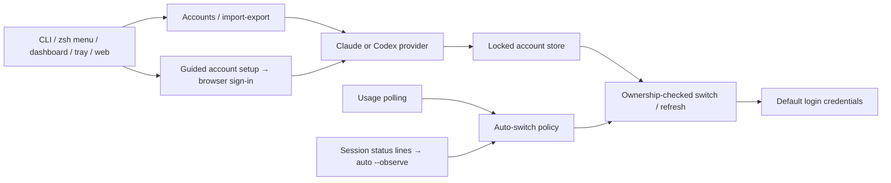

<p align="center">
  
</p>

# tycswap

**One machine, several Claude Code and Codex logins, never a logout.**

tycswap keeps every login you own for an agent CLI in a numbered slot, makes one
of them live, switches to another in place, and does that by itself before the
live one runs into its rate limit. It shows every account's usage windows in a
list, in a full-screen dashboard, in the browser and in a menu-bar / tray
icon, and runs a second account in its own terminal beside the live one. It works with the Claude Code CLI and the VS Code
extension, and ships as a single static Go binary for Linux, macOS and Windows.

It began as a fork of [dpemmons/cswap](https://github.com/dpemmons/cswap), the
Go port of [claude-swap](https://github.com/realiti4/claude-swap), and keeps
that command grammar, store layout and JSON contract. What it adds is a
second provider: **Codex (ChatGPT)** accounts get the same slots, in-place
switching, usage windows, auto-switch, dashboard rows and export/import as
Claude accounts, under `tycswap codex …` — see
[Codex accounts](#codex-chatgpt-accounts). tycswap is its own product with its
own binary, module and store; an existing store from the parent tools is copied
over once by [`tycswap migrate`](#move-over-from-claude-swap).

| | Claude Code | Codex (ChatGPT) |
|---|---|---|
| store a login, switch in place, alias, disable | yes | yes |
| usage windows in list and dashboard | 5h, 7d, per model | 5h, weekly |
| auto-switch before a limit | yes | yes, same `tycswap auto` loop and dashboard Auto tab |
| take over an existing switcher's registry | — | yes, from codex-auth |
| export, import, purge | yes | yes |

This document is the entry-point guide: concepts, installation, and the tasks a
user performs in order. The complete per-command contract — every argument,
default, exit status, JSON schema, and error condition — is in
[`docs/reference.md`](docs/reference.md). The architecture is in
[`docs/DESIGN.md`](docs/DESIGN.md).

## Concepts

**Account.** An account is a saved Claude Code login: an OAuth credential blob
(or an API key) together with a snapshot of the login's configuration. tycswap
holds accounts in its backup store and never alters the underlying Claude
subscription; it only moves credentials into and out of Claude Code's own
credential store.

**Slot.** Each account occupies a numbered slot. Slots start at 1 and may be
sparse — an account can sit at slot 5 while slot 4 is empty. Every command that
names an account accepts the slot number, the account email, or the account
alias interchangeably.

**Active login.** Exactly one account is active at a time. The active account is
the login Claude Code uses: its credentials are the ones written into Claude
Code's credential store and its identity fields into `~/.claude.json`. Switching
replaces the active login with another account's stored credentials.

**Backup store.** The backup store is a directory holding every managed
account's saved credentials and configuration, the account roster
(`sequence.json`), settings, the usage cache, former session profiles, and
the switch log. Its location is per-platform (see
[Data locations](#data-locations)). Switching copies credentials between the
backup store and the active login; it removes nothing.

**Usage windows.** Claude enforces rate limits over rolling time windows: a
5-hour window and a 7-day window, and — for accounts that use them — per-model
weekly windows. tycswap fetches each account's usage and reports the remaining
headroom as a percentage. An account is *at limit* when a relevant window has
reached or exceeded its limit. Auto-switch and the `best` switch strategy use
this headroom to choose a target; by default (`autoswitch.strategy`
`soonest-reset`) auto-switch orders the targets that qualify by earliest weekly
renewal, and `best` orders them by most headroom instead.

**Shared default login.** Every Claude session uses the default login, which
tycswap switches between accounts; no session is pinned to an account. The
per-account session profiles of `tycswap run` and `tycswap env` (removed, see
[Former session profiles](#former-session-profiles)) retire on their own.

**Relationship to claude-swap (Python).** tycswap is a Go port of claude-swap
(Python, MIT, by Onur Cetinkol). The two implementations share their on-disk
formats and `--json` schemas: an export file written by either implementation
is read by the other, and the layout inside the backup store is the same. The
store itself lives at its own path (see [Data locations](#data-locations)), so
the two never share one; `tycswap migrate` copies an existing claude-swap store
once. The command grammar,
exit codes, and lock protocol are identical. claude-swap's macOS menu bar
application is not ported; tycswap's own tray application, `tycswap app`, works
on macOS, Windows and Linux. The update mechanism, the
at-limit markers, and the Codex provider are Go-only; where the Go binary and the Python reference
diverge, the divergences are enumerated in [`docs/DESIGN.md`](docs/DESIGN.md)
§6 and its Amendments.

## Installation

**Prerequisites.**

- Go 1.21 or newer, which switches toolchains by itself under `GOTOOLCHAIN=auto`
  (the default of the standard Go distribution):
  - A build in a checkout (`make build`, `make install`) uses the patched
    toolchain that `go.mod`'s `toolchain` line pins, or your Go if it is newer.
  - `go install …@latest` runs outside any module and does not read that
    line. It builds with your Go when that meets the `go` line of the
    module's `go.mod`, and switches to a newer toolchain only when it does
    not. For the pinned toolchain, set `GOTOOLCHAIN` to the `toolchain` line's
    value (`GOTOOLCHAIN=go1.x.y go install …`).
  - With `GOTOOLCHAIN=local`, Go never switches: it must be at least the
    `go` line's version, and an older Go refuses to build.

  The CLI builds without cgo; on
  macOS the menu-bar app needs cgo (the Command Line Tools: `xcode-select
  --install`), and a build without it serves the tray app's dashboard alone.
- The Claude Code CLI, for the accounts to run against.
- macOS only: the `security` command, used to read and write the login Keychain.

**From a checkout:**

```bash
git clone https://github.com/tyclab/tycswap
cd tycswap
make build      # builds ./tycswap with the version embedded
make install    # go install with the version embedded
```

The binary is named `tycswap` and `make install` places it in the Go install
directory (`$GOBIN` when it is set, else `$GOPATH/bin`, else `$HOME/go/bin`). Add that directory to
`PATH`. `make help` lists every target.

**With `go install`:**

```bash
go install github.com/tyclab/tycswap/cmd/tycswap@latest
```

**From a release.** Every release on
[GitHub](https://github.com/tyclab/tycswap/releases) carries a binary for
Linux (amd64, arm64), macOS (amd64, arm64) and Windows (amd64), named
`tycswap_<version>_<os>_<arch>`, and a `SHA256SUMS` file:

```bash
sha256sum --check --ignore-missing SHA256SUMS
chmod +x tycswap_<version>_linux_amd64 && mv tycswap_<version>_linux_amd64 ~/.local/bin/tycswap
```

The binaries are **not code-signed**. macOS quarantines a binary downloaded
with a browser (`xattr -d com.apple.quarantine tycswap` lifts it, or download
with `curl -LO`); Windows SmartScreen may warn the first time (*More info* →
*Run anyway*). `go install` builds on your machine and avoids both. A release
binary upgrades itself: `tycswap upgrade` and the tray download the next
release over it after checking it against that release's `SHA256SUMS`.

## Tasks

Run `tycswap` to open the interactive menu, even while the tray is running.
Type to filter, use the arrow keys to choose, and press Escape to go back.
**Add account…** signs in with Claude or Codex through your browser, saves an
existing login, or adds a token. **Manage accounts…** switches, renames,
enables/disables, moves, or removes an account, and offers **Remove alias** on
an account that has one. It also offers **Sign in again…**
and **Use saved login** for Claude; renewing the active account activates its new login.
Where a Fable store can exist (not on macOS), **Add account…** also offers the
Fable sign-in, asking for the account (those without a Fable login first), and a
Claude account's menu offers **Sign in for Fable…**, and **Allow Fable** where
the plan says nothing or **Disallow Fable** where a mark decides (see
[Run accounts in parallel](#run-accounts-in-parallel)).
**Browse commands and options…** lists Claude and Codex commands, their options and
command help. Choose **Manage accounts… → Preferred models…** to change or clear
a Claude account's allocation. **Add account…** includes independent native
sign-in for an enabled OAuth account marked for Mythos on supported platforms.
To select an enrolled Fable login before a new native session, choose
**Browse commands and options… → switch --store fable --if-idle**. The current
login stays in place if a Fable session is running or starting.
**Import / export…** guides Claude and Codex file transfers.
**Open web dashboard** reuses the running app, starting it in the background if needed.
Closing the menu leaves the tray running.

The menu uses flakelab's zsh prompts: searchable choices, editable input, and
the answered question left on screen. Each action shows its command for reuse.
Release binaries include the prompt library; install `zsh` to use it. The Go
renderer remains available automatically when zsh is absent, including on Windows.

Incomplete account commands guide you too: `tycswap remove` asks for a Claude
account, `tycswap codex remove` asks for a Codex account, and `tycswap move 2`
asks for the destination slot. `tycswap config set` asks for the setting and
value. Complete commands, existing defaults, scripts and JSON calls keep their
behavior; `TYCSWAP_NO_PROMPT=1` disables automatic prompts.

The dashboard and the Linux and macOS tray menus also have **Add account…**
and **Interactive menu…**. The latter opens all account and transfer actions. They open guided setup in
a terminal; no command needs to be copied. On Windows that is a new tab in
your current Windows Terminal window when Windows Terminal is installed, else
a console window. A Windows tray connected to WSL
opens setup in the distro named by its token file. The web dashboard can send
that request through the connected Windows tray, even when the WSL service
has no desktop session. Setup loads your configured login shell so Claude and
Codex installed in your user directories remain available. Without a desktop or connected tray, use the menu in
your existing terminal. `tycswap menu add` opens setup directly.


The tasks below follow the order in which a user meets them. Each transcript is
complete. Prompt lines begin with `$`; all other lines are program output.

### Add the first account

Log into Claude Code as usual, then snapshot the current login into slot 1:

```
$ tycswap add
Added Account 1: alice@example.com [personal]
```

`tycswap add` reads the active Claude Code login, copies its credentials and
configuration into the backup store, and makes it the active managed account. If
no account is yet managed, it lands in slot 1.

### Add a second account

There are two ways to register another account, and neither touches the
current login.

To add an interactive (subscription) login, run `tycswap add --login`. It runs
Claude Code's own `claude auth login` in a private scratch profile, so the
browser flow signs the second account in beside the live one, and stores the
result in the next free slot:

```
$ tycswap add --login
Added Account 2: bob@example.com [personal] (from login)
```

The live login stays as it was and remains the active account; add `--switch`
to make the new account live straight away, through the same switch as
`tycswap switch 2`. Arguments after `--` go to `claude auth login`, for example
`tycswap add --login -- --email bob@example.com` or `-- --sso`. `--slot` and
`--alias` work as for `tycswap add`. If the account is already managed, its
stored credentials are refreshed in place; signing in as the account that is
already live also makes the new login the live one. This flow explicitly selects subscription
login (`--claudeai`) and rejects `--console` before starting Claude Code; API keys
belong in `add-token`.

Cleanup runs whether the login succeeds or not. On macOS it deletes only the
Keychain item made for this scratch profile, then removes the directory. If
cleanup fails, a warning names the retained private directory; the next
`add --login` retries marked cleanup without touching another active login
or a shared Console key. An account already saved stays saved.

To register an account from a setup token or API key, use `tycswap add-token`. The token is read interactively (not echoed) or
from `-` (standard input). Avoid passing it as an argument: the command line is visible to other local users through `ps`
and stays in your shell history, and tycswap warns when you do.

```
$ tycswap add-token --email bob@example.com --slot 2
Token:
Added Account 2: bob@example.com [personal] (from token)
$ pass show claude/bob-token | tycswap add-token - --email bob@example.com
```

`--slot` is optional; without it the account lands in the next free slot.
`--email` labels the account.

An API key for another endpoint, such as an LLM gateway or proxy, takes `--base-url`. The key is then that endpoint's,
whatever it looks like, and a switch to the account points Claude Code at it: tycswap writes the URL and the key into
Claude Code's `settings.json` as `env.ANTHROPIC_BASE_URL` and `env.ANTHROPIC_AUTH_TOKEN` and removes
`env.ANTHROPIC_API_KEY` (Claude Code would send that key to the endpoint too), after recording what those keys held, and
a switch to any other account puts exactly that back, leaving the rest of the file as it is. The switch warns when an
`apiKeyHelper` or an `ANTHROPIC_API_KEY` in your environment would still send a second key. `list` and `status` show the
endpoint's host; `--json` carries the whole URL as `baseUrl`.

```
$ pass show gateway/key | tycswap add-token - --base-url https://gateway.example.com --email gw@example.com
Added Account 3: gw@example.com [personal] (from API key for gateway.example.com)
```

### Switch accounts

Rotate to the next account in slot order:

```
$ tycswap switch
Switched to Account-2 (bob@example.com)
Accounts:
  1: alice@example.com [personal]
     usage unavailable (http-429)

  2: dev (bob@example.com) [personal] (active)
     usage unavailable (http-429)

  3: key@example.com [personal]
     API key (no quota)

  5: carol@example.com [personal] (disabled)
     usage unavailable (http-429)

New account is active on your next message — no restart needed.
```

Switch to a specific account by slot number, email, or alias:

```
$ tycswap switch 1
$ tycswap switch bob@example.com
$ tycswap switch dev
```

Switch by remaining quota instead of slot order:

```
$ tycswap switch --strategy best            # what the account order ranks first
$ tycswap switch --strategy next-available  # rotate, skipping at-limit accounts
```

Both count the windows a scheduled tick counts (the dashboard's *Counting
now* while a scheduler checks; an engine the dashboard hosts counts 5h and 7d
only): 5h, 7d and, while live sessions run a model some usable account can
serve, that model's weekly window (DESIGN A98). `best` ranks as auto-switch does under
`autoswitch.strategy` and takes the dashboard's *Best candidate*, staying put
when the live account ranks first (DESIGN A99).

**Restart semantics.** The follow-up line states whether Claude Code needs a
restart, keyed to where the credential write landed:

- On Linux, WSL, and Windows the active credentials are file-based. The line
  reads `New account is active on your next message — no restart needed.` The
  running Claude Code session picks up the new account on its next message.
- On macOS the active credentials are stored in the login Keychain. The line
  reads `Restart Claude Code to apply immediately — otherwise the session can
  take up to ~30 seconds to pick up the new account.`

### Read the list dashboard

`tycswap list` (alias `ls`) prints every managed account and its usage:

```
$ tycswap list
Accounts:
  1: alice@example.com [personal] (active)
     usage unavailable (http-429)

  2: dev (bob@example.com) [personal]
     usage unavailable (http-429)

  3: key@example.com [personal]
     API key (no quota)

  5: carol@example.com [personal] (disabled)
     usage unavailable (http-429)
```

Markers, per line:

- The leading number is the slot.
- `alias (email)` — when an account has an alias, the alias precedes the email
  in parentheses (slot 2 above).
- `[personal]` or `[Organization Name]` — the account's organization label;
  the plan Claude Code reports follows it when known (`[personal · Ultra]`).
  Claude.ai's placeholder "<email>'s Organization" counts as personal.
- `(active)` — the currently active login.
- `(disabled)` — held out of auto-rotation by `tycswap disable`.
- `(Mythos)` — marked by `tycswap mythos --allow` as an account that runs
  Claude Mythos.
- `at limit: <windows>` — a relevant usage window is at or over its limit; the
  suffix names the limiting windows (for example `7d` or `Fable 5`).

The second line per account is usage. For an OAuth account with a healthy fetch
it shows the 5-hour and 7-day percentages and reset times; `usage unavailable
(http-NNN)` reports a failed fetch and its HTTP status; `API key (no quota)`
marks an account authenticated by API key, which has no measured quota.

Add `--token-status` for each OAuth account's token expiry and refresh state:

```
$ tycswap list --token-status
Accounts:
  1: alice@example.com [personal] (active)
     usage unavailable (http-429)
     • oauth: unknown expiry, refresh token no
  ...
```

`tycswap list --json` and `tycswap status --json` emit one JSON document
(schemaVersion 1) instead of the human table; the schemas are in
[`docs/reference.md`](docs/reference.md). To extract the active account's email:

```
$ tycswap status --json | jq -r '.active.email'
alice@example.com
```

The full-screen interactive dashboard is `tycswap tui` (also `tycswap watch`;
a bare `tycswap` opens the action menu). It shows the same accounts with live usage and
refreshes on a timer. Its Settings screen (`c`, or the menu's "Settings…" row)
lists every `settings.json` key with its value and help text and edits it in
place — a bool toggles, a choice cycles, a number is typed and
validated like `tycswap config set` — and `u` resets a key to its default; the
auto-switch screen's own threshold adjustment (`t`, which moves the 7d bar)
stays session-only.

### Alias accounts

An alias is a short name usable anywhere an account is named:

```
$ tycswap alias 3 ops
Set alias 'ops' for Account 3

$ tycswap alias
Aliases:
  2: dev (bob@example.com)
  3: ops (key@example.com)

$ tycswap alias 3 --unset
Removed alias for Account 3
```

### Disable and enable accounts

A disabled Claude account stays in the roster. Enable it before selecting it
by hand or launching a managed session on it. An idle store moves to an eligible
replacement even with automatic rotation off. If no replacement is available,
tycswap clears the selection and keeps the saved login. A live session retains
its credential. Once the last client exits, an enabled auto-switch tick completes
the withdrawal. With auto-switch off, repeating disable retries it.

```
$ tycswap disable 2
Disabled Account-2 (bob@example.com).

$ tycswap enable 2
Enabled Account-2 (bob@example.com).
  It is back in the rotation.
```

### Auto-switch before a limit

Parallel Claude sessions use the same default login and all follow its
rotation. A session still running in a former `tycswap run`/`env` profile holds
that account until it exits; the dashboard and tray identify such accounts, and
a blocked tick reports `accounts-in-use` when they prevent rotation (see
[Former session profiles](#former-session-profiles)).

Auto-switch is off until you turn it on, from the CLI, the tray's
**Auto-switch** toggle or the dashboard's Start:

```
$ tycswap auto on
Auto-switch on.
$ tycswap auto status
Auto-switch: on
```

`tycswap auto off` turns it off again. The choice is one setting,
`autoswitch.enabled`, and every tick reads it first: the loop below, a
timer's `tycswap auto --once` and the app's engine alike. While it is off a
tick switches nothing and says `no switch: disabled`, `--once` exits 2, and
`tycswap auto` says once on stderr that it is off. The tray app keeps its
engine for as long as it runs, idle while off, so `tycswap auto on` from a
shell takes effect without touching the app.
`tycswap auto on --if-unset` turns it on only when nothing has set it yet,
for a provisioner that must not override a user's later "off".

A switch by hand (`tycswap switch`, the dashboard, the tray, the TUI) leaves
auto-switch as it is. For `autoswitch.cooldownSeconds` (300 by default) after
it, auto-switch makes no switch, even off an account at its limit, and each
tick in that time says `no switch: cooldown (switched by hand to account 4;
held for another 297s)`. After that it decides as always.

`tycswap auto` runs a foreground loop that polls usage and switches to another
account before the active one reaches its rate limit:

```
$ tycswap auto --seven-day-threshold 92
Auto-switch running: 5h 85% · 7d 92%, every 60s — Ctrl-C to stop
13:53:36  Account-1 (alice@example.com): usage unknown (http-429) (7d bar 92%) | others: #2: ? (http-429), #3: ?, #5: ? (http-429)
13:53:36  no switch: active-usage-unknown (1/3 before failover)
```

Each window has a limit of its own, set by how fast that window fills:

Ultra (formerly Max 20x) loses its five-hour limit as Anthropic verifies
accounts during its staged rollout. tycswap follows the windows returned by
Anthropic: an absent five-hour window does not block switching,
and weekly and counted model limits still apply. When the active account's
five-hour window reaches its bar, an account without one is a target while it
is below its weekly and counted model bars. A reported five-hour window
continues to count, including on Ultra accounts awaiting verification. Max
(formerly Max 5x) retains that window. No threshold changes are needed.

| flag / setting | window | default |
|---|---|---|
| `--five-hour-threshold` / `autoswitch.fiveHourThreshold` | 5h | 85 % |
| `--seven-day-threshold` / `autoswitch.sevenDayThreshold` | 7d | 97 % |
| `--model-threshold` / `autoswitch.modelThreshold` | per-model week | 95 % |

The 5h window **bursts**: a fan-out of parallel subagents can take it from
85 % to full between two polls, and hitting 100 % stops you mid-task with no
chance to react. Its bar is the lowest of the three so the next poll has room
to act. The weekly windows **creep**: they move at the pace of a week's work,
so there is always another poll between "nearly full" and "full", and they can
be squeezed close to full before moving. Raise the 5h bar if you work in
small, predictable steps; lower it (or poll more often) if you run wide
fan-outs. Set a bar to 100 to never switch off that window before it is
actually full. The model bar applies to the model windows counted for the
live sessions (below). When more than one window is over its bar, the costliest decides (the
week, then a model's week, then the 5h window), and the switch line names it
(`Switched Account-1 -> Account-2 (b@example.com) (proactive, 7d)`). A settings
file that still has the old single `autoswitch.threshold` keeps working: its
value seeds the 7d bar. The polling interval defaults to 60 seconds; Ctrl-C
stops the loop and exits 130.

**Single tick, for cron.** `tycswap auto --once` performs exactly one evaluation
and exits; `--json` prints the tick as JSON event lines:

```
$ tycswap auto --once --json
{"active":{"email":"alice@example.com","number":1},"event":"poll","fetchErrors":{"1":"http-429","2":"http-429","5":"http-429"},"headroomPct":{"1":null,"2":null,"3":null,"5":null},"schemaVersion":1,"threshold":80.0,"ts":"2026-07-17T20:49:40Z"}
{"detail":"1/3 before failover","event":"no-switch","reason":"active-usage-unknown","schemaVersion":1,"ts":"2026-07-17T20:49:40Z"}
```

The process exit code reports the outcome, so a scheduler can branch on it:

| Exit | Meaning  | Condition                                                    |
|------|----------|-------------------------------------------------------------|
| 0    | Switched | A switch happened.                                          |
| 1    | Error    | Network trouble, lock contention, or a transient failure.  |
| 2    | NoAction | Nothing to do — below threshold, in cooldown, idle, or auto-switch is off. |
| 3    | Blocked  | A switch was wanted but no viable target remained.         |

A crontab entry that ticks every five minutes and logs the result:

```cron
*/5 * * * * tycswap auto --once --json >> tycswap-auto.log 2>&1
```

cron runs with a minimal `PATH`; the entry finds `tycswap` only if its install
directory is on cron's `PATH` (set `PATH=` at the top of the crontab, or place
`tycswap` in a directory cron already searches).

**Per-model weekly limits.** When the status line feeds `tycswap auto
--observe` (see [`docs/reference.md`](docs/reference.md#tycswap-auto)), a
scheduled tick counts the per-model weekly windows of the models the default
login's live sessions run, and while none of them runs Fable it leaves
Fable-capable accounts to Fable work; nothing needs setting. Without status
line records auto-switch weighs only the account-wide 5-hour and 7-day windows.
The counted models always follow the live sessions (DESIGN A76, A91): the
`autoswitch.model` setting and the `--model` flags were removed (DESIGN A97),
and `tycswap auto --model` or `tycswap switch --model` exits 2. A session's
model family is matched, case-insensitively, against the display names of the
account's scoped weekly windows (`fable` counts `Fable 5`). An exhausted
counted per-model weekly window then reads
as at-limit even when the account-wide 7-day window has headroom.

**Renewal-ordered switching.** By default auto-switch tries the qualifying
target with the earliest weekly renewal first (`autoswitch.strategy
soonest-reset`): the account whose 7-day window — and any counted per-model
weekly windows — refills earliest is tried first, so quota is spent where it
returns soonest and no account sits idle on a window that is about to renew.
`best` instead tries the target with the most headroom first. Qualification
itself is the same under both. On a proactive switch, a target
must still land under the threshold and beat the active account by the
hysteresis margin, both measured on the window that triggered the tick; when
that is the five-hour window, an account without one needs only to be under
all of its own bars. On an
at-limit or failover switch neither check applies, but `soonest-reset` still
never lets an early renewal beat a threshold: an account at or above one of its
bars is tried only after every account below all of them, regardless of how
soon it renews. Whatever the trigger, an account whose week (or a counted model
week) is spent is never a target, and `best` ranks by weekly headroom rather
than by the fullest window.

```
$ tycswap config set autoswitch.strategy best
autoswitch.strategy = best
```

A settings file that does not name a strategy uses `soonest-reset`; one that
sets `best` keeps it.

**Auto-switch never changes how Claude Code authenticates.** It rotates
between subscription accounts only. It does not move onto an API-key account
when every subscription account is at its limit (it reports the wall
instead), and it does not move off one that you made active. An API-key
account replaces the subscription login with a key billed per token, and a
Claude Code session that is already running keeps the login it started with
until you restart it; an automatic switch into that state would leave every
open session on the old login while tycswap reports the new one. Switching to
an API-key account by hand asks first and says how many sessions you will have
to restart:

```
$ tycswap switch 3
An API-key account authenticates with a key instead of a subscription login, and its usage is billed per token.
2 Claude Code sessions are running; they keep their current login until each one is restarted.
Switch to API-key account #3? [y/N] y
Switched to Account-3 (key@example.com)
```

`--yes` (`-y`) answers the question for scripts. Without a terminal and
without `--yes` the switch is refused at once, and any answer but `y` cancels
it; both exit 1. The bare `switch` and `switch --strategy` skip API-key
accounts. The browser dashboard's *Switch* asks before switching to one; the
TUI and the dashboard's *Force switch* do not ask and refuse, pointing at
`tycswap switch <n>`.

### Start on a marked login

Mark the accounts you want `start` to prefer when launching a command:

```sh
tycswap start --allow work
tycswap start --list
tycswap auto on
tycswap start -- /absolute/path/to/real/claude --resume
```

Use `--disallow ID` to remove a mark. Account numbers, aliases and unambiguous
emails work as IDs. The dashboard offers **Allow for start** / **Disallow for
start** on Claude rows; `list`, the dashboard and the tray show `start login`.
Marks belong to the account and survive re-login, re-add, move and swap. A
forced import of an existing identity retains its local mark, disabled flag
and alias when the export has no alias. New identities start unmarked.

With auto-switch on, `start` leaves a marked current login alone; otherwise it
picks an eligible marked subscription account using cached usage and the
engine's counted-model checks. Accounts below every configured bar rank first,
then other usable or unknown readings, then accounts at a limit: a start login
is used even when it is at its limit, since a session needs it only to start.
It makes no usage request. `--account ID` chooses only that account, without
requiring a mark, and works while auto-switch is off; all other eligibility
checks still apply. This does not grant model access or change managed policy.

A Fable session that starts on the Fable store (see [The Fable
store](#run-accounts-in-parallel)) selects a login in that store only. The marked
accounts with a usable Fable login are its candidates, ranked the same way, and `start` moves the Fable store to the
first (`tycswap start: Fable store: Switched to start login Account-2.`). With
marks but no usable Fable login among them, the session starts on the default
login (`tycswap start: no start login has a Fable login; starting on the
default login.`). `--account ID` is the Fable store's only candidate when it
has a usable Fable login, else the same notice. Without marks, or with
auto-switch off and no `--account`, the Fable store stays where it is.

Selection is best effort. Missing marks and an already-marked current login
are silent. An unavailable target or store prints a clear error on stderr,
then launches once on the current login. An actual switch stamps the engine's
cooldown, but cached data can be stale and other sessions and the engine share
the same default login. Another switch can happen before the child reads it.
Executable launch failures exit nonzero and never rerun the command.

A session that starts on a login at its limit, while auto-switch is on, gets a
start hold: auto-switch moves nothing until the session is up (`Switched to
start login Account-2, which is at its limit; auto-switch moves on once the
session is up.`). The session reports that it is up through a SessionStart
hook in Claude Code's settings (`~/.claude/settings.json`):

```json
{"hooks": {"SessionStart": [{"hooks": [{"type": "command", "command": "tycswap start --started", "timeout": 45}]}]}}
```

A Fable session held on the Fable store's start login holds the Fable
store's check with its own token. `tycswap start
--started` ends the session's holds and, once no other session is starting,
runs one auto-switch check, which moves the logins on. Without the hook a login
stays for 30 s, then moves at the next check, and the session's first request
can hit the limit.

The child's arguments pass unchanged, and so does its environment, except
`TYCSWAP_START_HOLD` (set for a session with a start hold, removed from any
other) and `CLAUDE_SECURESTORAGE_CONFIG_DIR` while a Fable store exists: a
session whose model is Fable (`--model`, `ANTHROPIC_MODEL`, a settings
`env.ANTHROPIC_MODEL`, the resumed session's model, then a settings `model`;
the settings are `--settings` and Claude Code's three settings files) starts on
the Fable store when it has a usable login, and every other session drops a
value naming the Fable store. `tycswap start` cannot see a Fable model chosen
by `--model default` or none at all, by `ANTHROPIC_DEFAULT_MODEL` or
`ANTHROPIC_DEFAULT_<FAMILY>_MODEL`, by managed settings or inside a wrapper
command; such a session starts on the default login. A set `CLAUDE_CONFIG_DIR` (even empty), `--bare`, or a Claude
authentication override (a `CLAUDE_SECURESTORAGE_CONFIG_DIR` of your own
included) skips selection and passes everything else unchanged, including an
explicit `--account` request. Options for tycswap end at `--` or the first
command. Without a command, `start` resolves the real
Claude executable; failure to resolve it safely is a launch error.

A manual shell launcher must use a verified real executable path:

```sh
claude() { tycswap start -- /absolute/path/to/real/claude "$@"; }
```

The real path must not resolve back to a launcher. A launcher invokes tycswap
once and returns its status; a nonzero child exit must never trigger a retry.

### Mark the accounts that run Mythos

Only some accounts may run Claude Mythos, nothing tycswap reads says which,
and Claude Code checks it on every request against the shared login. Mark
them:

```sh
tycswap mythos --allow 2
tycswap mythos --allow work
tycswap mythos --list
```

`--disallow ID` removes a mark. While a session runs Mythos and a marked
account has room (or the live one is marked and not at its limit),
auto-switch keeps the shared login on a marked account: it never moves to an
unmarked one, and from an unmarked one it moves to a marked account below
every bar at once. `tycswap start` starts a Mythos session on a marked
account (the start-login marks do not apply to it) and every other session
too while a Mythos session runs. With no account marked, or none with room,
nothing is restricted, so the other sessions keep running; `start` says so
once per Mythos session when none is marked. `list`, the dashboard (**Allow for Mythos**) and the tray
show the mark; the Auto tab's caption names the accounts a live Mythos session
leaves the login, e.g. `live Mythos session: only accounts 2, 5`. Mythos
sessions on the Fable store are not covered.

### Use an independent Mythos login

On Linux, WSL and Windows, an existing subscription account can have a
separate Claude sign-in for new Mythos sessions. For example, to enroll
account 2 and allocate its quota to Mythos and Fable:

```sh
tycswap mythos --allow 2
tycswap add --login --lineage mythos --slot 2
tycswap models 2 mythos,fable
```

The browser sign-in must match the enrolled account and organization.
Each enrolled identity has its own credential directory. A new Mythos
session starts Claude with the selected directory. The native client
checks model access on that login. In-process subagents share their
parent session's login. Removing the account also removes its independent
credential. Moving the same account to a new slot preserves the credential.

`tycswap models --list` shows explicit allocations. Use
`tycswap models 2 --derived` to clear the allocation for account 2.
A launch outside the account's explicit allocation asks before starting
Claude. A resumed independent session keeps its original identity across
restarts and checks both shared and model quota. When a known window is full,
the login becomes available again after its reset. Each computer needs its
own browser sign-in.

### Run accounts in parallel

Plain `claude` needs nothing from tycswap: every session runs on the default
login, and auto-switch moves that login by the models the sessions run (see
[Auto-switch before a limit](#auto-switch-before-a-limit)). All sessions share
one account at a time, and subagents run on their session's account.

**The Fable store.** An account can hold a second, independent sign-in, its
Fable login. The Fable store (`<backup store>/fable/store/`) holds one of them
live, and Fable sessions run on it through Claude Code's
`CLAUDE_SECURESTORAGE_CONFIG_DIR`, while every other session stays on the
default login; tycswap switches the two independently and never moves a login
between them. `tycswap start`, and so a `claude` launcher built on it, picks
the store by the session's model; a Fable session on a Fable store without a
usable login starts on the default login and says so. `tycswap switch --store
fable <n>` switches it by hand and `tycswap switch --store fable --empty` turns
it off. `tycswap auto --once` rotates it too: after the default tick, a second
tick moves the Fable store to an account with Fable room, while the default
login leaves those accounts to it and fills the ones whose Fable week is
spent; the `tycswap auto` loop and the dashboard's own engine do not. When
the Fable store's own login dies, that tick quarantines it and moves the store
to another account's Fable login, or empties it. A box
where no account has a Fable login works exactly as before. macOS has no
Fable store.

To add a Fable login, sign each account in a second time, once per account and
box, after it has been added:

```
$ tycswap add --login --lineage fable --slot 2
Sign in as bob@example.com in the browser.
Stored the Fable login for Account-2 (bob@example.com).
The Fable store now uses Account-2.
```

The browser flow is the one `add --login` runs; sign in as the account named.
An account runs Fable by its plan (Max or Ultra). An organization's login often
names no plan; mark it if it runs Fable, before its sign-in:

```
$ tycswap fable --allow 3
$ tycswap fable --list
1  alice@example.com  Fable: yes, plan max     Fable login: yes
3  carol@example.com  Fable: yes, marked       Fable login: no
```

`tycswap fable --disallow 3` removes the mark, so the plan decides again; the
mark stays with the account across a re-add, a move and a forced import of it.
Only the Fable login is stored: the default login, the roster and
`~/.claude.json` stay as they were. The first Fable login turns the Fable store
on; later ones are only stored, unless `--switch` is given. A sign-in as another
account, one not added yet, one whose plan has no Fable and no mark, or the
account's default login stores nothing; with `--slot` an account without Fable
is refused before the browser opens. A Fable login stays with the account it was
signed in as: `remove`, `move`, `swap` and an `add --slot` that moves an
account take it along, an `add --slot` that puts another account in a slot
deletes the old one's, an `add --slot` of the account already in the slot
keeps it, `purge` deletes the Fable store, and `export` and
`import` never carry a Fable login.

**Session groups are retired.** The Fable and Opus / other groups and
`tycswap claude` are gone; plain `claude` follows the session's model on the
default login instead. A former group hands its account back on the first
auto-switch tick after its last session exits, and its conversations are
copied into the default profile, so `claude --resume` continues them.

**The handover after a limit is removed.** `tycswap recovery`, the
dashboard's *Continue after a limit* card and *Continue in Codex…* button and
the tray's *Session at limit* item are gone: a session parked on a limit goes
on when the login has room. Every `tycswap recovery` verb exits 2 with a line
saying so, except `recovery record`, the hook a former group session may still
run, which exits 0.

#### Former session profiles

`tycswap run`, `env`, `map` and `unmap`, which pinned a terminal or a directory
to one account in its own profile under the store's `sessions/` directory, are
removed: they exit 2 with a pointer to the shared login. A profile left behind
keeps its account while a Claude session still runs in it. In a shell whose
`CLAUDE_CONFIG_DIR` still names one, tycswap's own commands work on the default
login and say so on standard error, but `claude`, plain or through
`tycswap start` (which passes the environment on unchanged), still uses that
profile: unset it first (`unset CLAUDE_CONFIG_DIR`; fish
`set -e CLAUDE_CONFIG_DIR`; PowerShell `Remove-Item Env:CLAUDE_CONFIG_DIR`), as
the notice and the removed commands' message say. `mappings.json` is no longer
read.

Once no session runs in it, the next scheduled auto-switch tick (also while
auto-switch is off) copies the profile's conversations into the default
profile, so `claude --resume <id>` continues them on the shared login, and
returns its login to the account: saved into the slot after the usual
ownership check, or dropped when it is stale or a copy of the live login. A
profile whose login cannot be verified keeps it, and the dashboard and tray
say why.

### Export and import

`tycswap export` writes accounts to a portable file for transfer to another
machine:

```
$ tycswap export backup.tycswap
Exported 4 account(s) to backup.tycswap

$ tycswap export bob-only.tycswap --account 2
Exported 1 account(s) to bob-only.tycswap
```

`--account` limits the export to one account. The export file is JSON with
`encrypted: false`; the format is identical to claude-swap's, so either
implementation imports the other's exports.

`tycswap import` reads accounts back:

```
$ tycswap import backup.tycswap
Imported alice@example.com → slot 1
Imported bob@example.com → slot 2
Imported key@example.com → slot 3
Imported carol@example.com → slot 5
Done: 4 imported, 0 overwritten, 0 skipped
Note: alice@example.com is your current live login — activate the imported credentials with: tycswap --switch-to 1 --force
```

Import skips a slot already holding a different account unless `--force` is
given, which overwrites it. Import rejects any file marked `encrypted: true`.

### Configure settings

Rotation tuning lives in the dashboard's **Settings** and `tycswap config`.
The 5-hour threshold is 85% by default: a 15% reserve before the provider's
limit, not a provider requirement. Changing presentation does not change the
saved policy.

`tycswap config` prints the settings and their values, marking each unchanged one
`(default)`:

```
$ tycswap config
autoswitch.enabled            true
autoswitch.fiveHourThreshold  85             (default)
autoswitch.sevenDayThreshold  92
autoswitch.modelThreshold     95             (default)
autoswitch.intervalSeconds    60             (default)
autoswitch.codexEnabled       true           (default)
autoswitch.codexThreshold     0              (default)
autoswitch.cooldownSeconds    300            (default)
autoswitch.hysteresisPct      10             (default)
autoswitch.strategy           soonest-reset  (default)
autoswitch.unhealthyTicks     3              (default)
```

`tycswap config set KEY VALUE` validates and stores one setting. An out-of-range
value is rejected and nothing is written:

```
$ tycswap config set autoswitch.sevenDayThreshold 92
autoswitch.sevenDayThreshold = 92

$ tycswap config set autoswitch.sevenDayThreshold 40
Error: autoswitch.sevenDayThreshold must be between 50 and 100
```

Each key's type, default, and range are listed in
[`docs/reference.md`](docs/reference.md).

### Upgrade

`tycswap upgrade` (alias `update`) updates the binary in place. When tycswap was
installed with `go install github.com/tyclab/tycswap/cmd/tycswap@…`, it re-runs
that for `@latest`. A binary built from a checkout is never replaced from the
remote; it says so and leaves the update to you:

```
$ tycswap upgrade
tycswap was built from a checkout: git pull && make install
```

The newest release is the one the releases page's `latest` link redirects
to, not an answer of GitHub's API, which allows a network 60 unauthenticated
requests an hour. When GitHub limits the network anyway, the check says `GitHub is
limiting requests from this network; try again later`, with the time when
GitHub names one.

A release binary (the builds a release publishes) is replaced by the newest
release's build for this machine
(`tycswap_<version>_<os>_<arch>` from the
[releases](https://github.com/tyclab/tycswap/releases)), downloaded over https
next to it, checked against that release's `SHA256SUMS` (a build without
exactly one matching line is refused) and renamed over the running file:

```
$ tycswap upgrade
Updated tycswap 0.6.0 → 0.7.0 (/home/me/.local/bin/tycswap).
```

A release binary that a package manager installed (in the Nix store, a
Homebrew Cellar, Scoop's apps or WindowsApps, or started through a symbolic
link) is left to that package manager, and `tycswap upgrade` says so; one in a
directory or file tycswap cannot write is upgraded by hand from the releases
URL it prints. A go-installed binary outside a Go bin directory is never
downloaded over: `upgrade` prints the `go install` line. On Windows a go-installed
`tycswap.exe` is not replaced while it runs; `upgrade` prints the `go install`
command for the user to run. A downloaded `tycswap.exe` is replaced in place
(the running file is moved aside to `tycswap.exe.old`, which goes at the next
start of the tray application).

### Move over from claude-swap

tycswap keeps its data in its own store and never reads or writes the store of
claude-swap (or of the fork tycswap came from). To bring an existing store
over, copy it once:

```
$ tycswap migrate --dry-run
Would copy ~/.local/share/claude-swap
  to ~/.local/share/tycswap
  ...
$ tycswap migrate
Copied ~/.local/share/claude-swap
  to ~/.local/share/tycswap
  6 directories, 14 files, 3 symlinks
  ...
  renamed claude-swap.log -> tycswap.log
The old store was only read; remove it yourself once nothing else uses it.
```

`migrate` copies only into an empty tycswap store and refuses otherwise; it
never moves, changes or deletes the old store or its Keychain items, because
another tool may still use them. Until the copy is made, every other command
prints a one-line reminder on standard error. The full contract is in
[`docs/reference.md`](docs/reference.md#tycswap-migrate).

### Remove and purge

`tycswap remove <num|email>` unmanages one account, deleting its stored
credentials and configuration from the backup store. It prompts for
confirmation first; any answer other than `y` cancels. `tycswap disable` (above)
keeps the account but drops it from auto-rotation.

`tycswap purge` removes all tycswap data, retaining empty coordination files in
the store directory. Running session profiles and managed launches block purge;
it checks again after confirmation. Any answer other than `y` cancels:

```
$ tycswap purge
This will remove ALL tycswap data from your system:
  - Backup directory contents: ~/.local/share/tycswap
  - All stored account credential files

Note: This does NOT affect your current Claude Code login.
Empty coordination files remain in the backup directory.

Are you sure you want to purge all data? [y/N] n
Cancelled
```

### Dashboard

`tycswap web` serves a dashboard in the browser on `127.0.0.1` and opens it:

```
$ tycswap web
Dashboard: http://127.0.0.1:52117/?token=<one-time token>
Press Ctrl-C to stop.
```

*Dashboard* lists the accounts with their 5h, 7d and model windows and every
account action (switch, add the current login, add a token, enable/disable,
alias, move, swap, remove), says when Claude Code is signed in with an
account that is not stored yet, warns when an `ANTHROPIC_*` variable or a
`settings.json` key makes Claude Code ignore the stored login, and shows what
can be updated: a newer tycswap release and a newer Claude Code from the
installer it was set up with, each installed from the page after a
confirmation (the header carries the count on every tab; the check runs at
start and every six hours). *Auto* has one *Auto-switch* switch
(`autoswitch.enabled`), says who checks (a scheduler and its last check, or
the dashboard and how often) and what is counted now, with the *Next best*
ranking and quarantine; *Sessions*
lists the running Claude Code sessions (also those started with `tycswap
run`) and can stop one; *Settings* edits the `settings.json` keys with their
type, range and default, the keys of `tycswap config`,
and lists *Poll interval* only while the dashboard runs the checks; *Guide* explains
the tool. The Accounts and Updates cards fold, and the choice is remembered.
Choose **Interactive menu… → Import / export…** to transfer accounts through a terminal launched from the dashboard or the Linux and macOS tray menu. Files contain account tokens; the guided export asks before writing and requires a new destination.

Only the browser tab that opens the printed URL can use the page: the token
in it works once, the server listens on loopback only, and every API call
needs the session cookie and a per-launch CSRF token the tab received from
the launch URL alone (a new tab needs a fresh URL). On WSL the browser opens on
the Windows side through `wslview` or an `xdg-open` that translates Linux
paths. On a machine with Codex accounts the dashboard lists them under their
own heading after the Claude accounts, with switch, disable / enable and
remove, *+ Add current Codex login* stores the codex CLI's login, and
auto-switch rotates them beside the Claude accounts, as `tycswap auto` does;
alias, move, swap, export and import of Codex accounts are available through the interactive menu or `tycswap codex`. See `docs/reference.md`, `tycswap web`, for the API and the security
model.

With a Fable login on some account ([The Fable store](#run-accounts-in-parallel)),
the header names the Fable store's account under the active one (`Fable: #2
bob@example.com`, or `Fable store off`), the Fable store's row carries a
`Fable` chip and rows with another usable Fable login a `Fable login` chip
(`Fable login: sign in again`, in the warning colour, for a quarantined one,
with the command that signs it in again). **Use for Fable** in such a row
switches the Fable store there by hand, which holds the Fable store's
auto-switch for the cooldown; the store's own row reads **Fable here**. The
Auto tab adds one line, `Fable store: counting 5h + 7d + Fable · next #3`
while a scheduler runs the checks; while the dashboard runs them it says that
its checks do not move the Fable store, since only `tycswap auto --once` runs a
Fable tick. With auto-switch off it reads `Fable store: not checked while off`,
and with the Fable store off it names the command that turns it on, since no
check moves the store then.
*Switch*, *Switch now* and the best candidate stay the default login's. The
terminal dashboard (`tycswap tui`) shows the default login only.

### Tray application

Dashboard **Settings → Appearance** offers Auto, Light and Dark. Auto follows
the browser's device-theme preference; Firefox can override that preference.
The choice is saved in a non-secret cookie. Account rows show when usage was
fetched and the next scheduled attempt; a rate-limited refresh keeps the last
trusted measurement visible and waits for its retry delay.

The Windows tray follows **Windows Settings → Personalization → Colors →
Choose your default app mode**, including changes while the app is running.
High contrast uses Windows' system colors.

`tycswap app` is the dashboard as a menu-bar (macOS) or notification-area
(Windows, Linux) icon. Choose **Start tray app** in the `tycswap` menu to start
it in the background. `tycswap app` runs it in the foreground.

On Windows, clicking the icon opens the daily view: one row per account with
its name, the plan Claude Code reports under it, and a column for each limit
(5-hour, weekly, each reported model window). A cell shows the **used quota**
with a bar and, under it, when that limit resets and how long that is
(`Sat 10:00 · 2d 22h`); the share and bar turn orange at the limit's
auto-switch threshold. `—` means no such window was reported, which is how a verified
Ultra login's 5-hour column reads, or that the plan cannot run Fable. Fable at
100% does not mean the shared weekly limit is exhausted. **Switch** switches
the default login at once and leaves auto-switch as it is; like every switch
by hand it holds auto-switch for the cooldown ([Auto-switch before a
limit](#auto-switch-before-a-limit)). The line under the list says what
happened, and the active account reads **In use**. The footer has **Quit**, **Check for updates…**, the
update buttons while an update waits, the **Auto-switch** and **Start at login**
switches and **Open dashboard**. **Check for updates…** starts the dashboard's
check and opens its Updates section, including with `--no-update-check`. A
remote tray checks the dashboard's machine; package-managed builds keep their
normal update instructions. Tab moves through the buttons, Space or Enter presses one, Esc
closes the panel. Settings and Add account are in the dashboard (and
`tycswap config`, `tycswap add`). Start at login is local to the tray's
device.

With a Fable login on some account, the Fable store's row carries a second
outlined label, `Fable`, after its plan, and every row the Fable store can
take (enabled, its Fable login usable, a plan that runs Fable, not
quarantined) has **Use for Fable** beside **Switch**: it switches the Fable
store there through the dashboard, as the dashboard's button does, and a
click while one is under way is dropped. **Switch** and **In use** stay the
default login's. The icon's tooltip reads `Default #1 · Fable #2` (or `Fable
off`).

macOS and Linux retain their platform menus, where a switch acts the same
way; with a Fable login the Fable store's account row's second line ends in
` · Fable` and each account the Fable store can take has a `Use for Fable: #N`
item after the account rows. The icon's title reports the active
account and its fullest counted window (`#1 · 45%`, with `⟳` while the hosted
engine runs). Notifications report switches, quarantines and thresholds.
Update checks and installation retain the normal release checks and restart
behavior ([Upgrade](#upgrade)). Builds managed by Nix show their upgrade path.

```
tycswap app [--open] [--headless] [--port N] [--interval SECONDS] [--no-update-check] [--debug]
tycswap app --autostart on|off|status
```

`tycswap app` runs in the foreground; choose **Start tray app** in the menu
to start it in the background. `--headless` runs the dashboard server without an icon
(what Linux without a StatusNotifierWatcher gets anyway), `--interval` sets
how often the live state is polled (default 5 seconds), `--debug` logs errors
to stderr, `--autostart`
registers start at login (a LaunchAgent, an XDG autostart entry, a `Run`
value) and exits. On Windows, where a scheduled task named like that entry
starts the tray at logon (a provisioner's), the task is the one entry:
**Start at login** and `--autostart` enable and disable it, remove a `Run`
value of the same name, and `--autostart status` names it. One app runs
per machine: a second one says it is already running, and `tycswap purge`
refuses while one runs. The background app logs to
`~/Library/Logs/tycswap.log` on macOS and to `app.log` in the backup store
elsewhere.

**When a timer owns auto-switch.** Set
`TYCSWAP_AUTO_MANAGED_BY=flakelab-tycswap-autoswitch.timer` in the dashboard
service environment (or name your scheduler). It only means "do not host an
engine here": the app starts no engine of its own, so a second engine never
runs beside the timer's. The tray's toggle and the dashboard's Auto-switch
switch still work: they turn `autoswitch.enabled` on and off, which the timer's
`tycswap auto --once` reads on every tick, and they show that setting as on
or off. The Auto tab says `checked by <scheduler>, last check <time ago>`,
and the Settings tab leaves out *Poll interval*, which `auto --once` never
reads. Seed the setting from the provisioner with
`tycswap auto on --if-unset`. This declares ownership; it does not probe
whether the named scheduler is currently active.

Flakelab manages the package, service and timer without overwriting saved
tycswap policy settings. Its `auto --once` checks reload those values each
time. The external timer controls cadence; `autoswitch.intervalSeconds`
only controls a continuous tycswap loop, which loads the settings when it
starts.

**Model windows.** The model windows counted always follow the models the
live sessions run (DESIGN A76, A91); the Auto tab's *Counting now* line says
what is counted and why. `autoswitch.model` was removed (DESIGN A97), so
nothing a user sets replaces that set; an engine hosted by the dashboard
counts 5h and 7d only. The Windows table shows each reported limit
independently; the icon's summary counts only the counted windows.

**WSL: the Windows tray for the engine in the distro.** Inside WSL there is no
tray, so the app there runs headless and the Windows binary shows the icon. In
the distro, keep the app running on a fixed port, best as a systemd user
service (WSL runs systemd when `/etc/wsl.conf` has `[boot]` `systemd=true`):

```ini
# ~/.config/systemd/user/tycswap.service
[Unit]
Description=tycswap dashboard for the Windows tray

[Service]
# The path `command -v tycswap` prints.
ExecStart=%h/go/bin/tycswap app --headless --port 7337
Restart=on-failure

[Install]
WantedBy=default.target
```

```bash
systemctl --user daemon-reload
systemctl --user enable --now tycswap.service
sudo loginctl enable-linger "$USER"
```

A user service starts with the user's first login to the distro;
`loginctl enable-linger` starts it when the distro boots, so the Windows tray
finds it without a shell open in WSL.

For a one-off start without systemd: `setsid -f tycswap app --headless --port
7337 >> ~/.local/share/tycswap/app.log 2>&1`. The app writes a per-start token
to `~/.local/share/tycswap/remote.token` (`$XDG_DATA_HOME/tycswap/remote.token`
when `XDG_DATA_HOME` is set) and removes it when it stops. On Windows, register
the tray for that engine at login and start it now (`Start-Process` gives it a
console of its own, which the app then closes):

```powershell
$token = '\\wsl.localhost\<distro>\home\<user>\.local\share\tycswap\remote.token'
tycswap.exe app --remote http://127.0.0.1:7337 --token-file $token --autostart on
Start-Process tycswap.exe -ArgumentList 'app', '--remote', 'http://127.0.0.1:7337', '--token-file', $token
```

Windows reaches the distro's `127.0.0.1:7337` through WSL2's localhost
forwarding (on by default). The token is only accepted on loopback, the file
is readable only by its owner in the distro, and a new start writes a new
one, which the tray reads again by itself. The remote tray switches, toggles
auto-switch and opens the distro's dashboard; Claude
Code's updates and *Add current login* stay on the distro's dashboard. Until
the distro's app answers, the icon shows `⚠`.

### Native tray adapter

`github.com/tyclab/tycswap/desktop/tray` exposes the native icon, menu, tooltip
and notification shell to other Go programs. It starts no account store, web
dashboard or credential flow. Pass a product icon, `Name`, `Identifier` and a
command callback to `New`, then call `Run` from the main goroutine. Callbacks
must return promptly.

`New` checks the options on every platform: `Identifier` is a letter followed
by up to 100 letters, digits, `_`, `.` or `-`; `Name` is at most 100 UTF-16
units; neither `Name` nor `Tooltip` contains NUL. On Windows a process holds
one tray at a time: a second `New` fails until the first tray's `Run` returns.

`Name` and `Identifier` replace tycswap's name where the platform has a slot
for it: the Windows window title and class, and the Linux StatusNotifierItem
title (until `SetTitle`), notification app name and item `Id`. macOS has no
such slot. The menu accent colour stays tycswap's on macOS and Windows.
`OnActivate` runs when a Linux tray host sends the item a primary click
instead of opening its menu.

On Windows, `OnSystemEvent` receives these names (the package's `Event*`
constants) on the UI thread:

| Event | Windows source |
|---|---|
| `suspend` | `PBT_APMSUSPEND` |
| `resume-automatic` | `PBT_APMRESUMEAUTOMATIC`: every wake; it does not prove a user is present |
| `resume` | `PBT_APMRESUMESUSPEND`: after `resume-automatic`, once the user is present |
| `display-change` | `WM_DISPLAYCHANGE` |
| `console-connect`, `console-disconnect` | `WTS_CONSOLE_CONNECT`, `WTS_CONSOLE_DISCONNECT` |
| `remote-connect`, `remote-disconnect` | `WTS_REMOTE_CONNECT`, `WTS_REMOTE_DISCONNECT` |
| `logon`, `logoff` | `WTS_SESSION_LOGON`, `WTS_SESSION_LOGOFF` |
| `lock`, `unlock` | `WTS_SESSION_LOCK`, `WTS_SESSION_UNLOCK` |
| `remote-control` | `WTS_SESSION_REMOTE_CONTROL` |
| `session-events-unavailable` | `Run` could not register for session notifications; power and display events still arrive |

Session events report the tray's own Windows session. `Run` registers for
them once the icon is shown and unregisters before its window is destroyed.
The application owns its desired state, debounce, process ownership and
recovery policy.

### Status line integration

tycswap keeps `statusline.json` in the backup store (see Data locations)
current for Claude Code status lines: it is rebuilt after every switch, roster
change and usage poll, so a status line reads one file instead of running
tycswap. Accounts are keyed by `<emailAddress>|<organizationUuid>` from
`~/.claude.json`'s `oauthAccount` (a null organization is empty), so take the
key from your session's live config. Each entry has `slot`, `label` (alias,
else organization name, else email; the placeholder "<email>'s Organization"
counts as none), `plan` when Claude Code reported one, and `usage`, null until measured, with
`fetchedAt`, `pollIntervalS`, `fiveHour`/`sevenDay` `{pct, resetsAt}` and
`scoped` per-model windows; every time is an integer epoch. Treat usage as
stale when `now - fetchedAt >= 2 * pollIntervalS`. No key or token is ever in
the file. One `jq` call prints the live account (on macOS and Windows the file
is `~/.tycswap/statusline.json`):

```sh
jq -r --arg k "$(jq -r '.oauthAccount | "\(.emailAddress)|\(.organizationUuid // "")"' "${CLAUDE_CONFIG_DIR:-$HOME}/.claude.json")" \
  '.accounts[$k] // empty | "\(.label) 5h \(.usage.fiveHour.pct // "-")% 7d \(.usage.sevenDay.pct // "-")%"' \
  "${XDG_DATA_HOME:-$HOME/.local/share}/tycswap/statusline.json"
```

The schema is under STATUS LINE STATE in [`docs/reference.md`](docs/reference.md).

With a Fable store, the status line can pipe its JSON into `tycswap start --check`.
When a Fable session is on the default login, or another model is on the Fable store,
the check identifies the model family, the active store and where to use an
account approved for that model. If none of the start logins
has a Fable login, it names that cause. Auto-switch ignores a Fable session on the
default login while the Fable store is usable (DESIGN A108).

### Codex (ChatGPT) accounts

tycswap also switches [Codex](https://github.com/openai/codex) accounts, under a
`codex` namespace. Bare `tycswap list` and `tycswap switch` keep meaning Claude, so
no existing command changes.

```bash
tycswap codex list                     # accounts + 5h/weekly usage
tycswap codex list --skip-api          # cached usage only, no network
tycswap codex list --token-status      # token expiry (never prints the token)
tycswap codex list --json              # machine-readable
tycswap codex status                   # the account codex is running as
tycswap codex switch                   # rotate to the next account
tycswap codex switch 2                 # or by number / email / alias
tycswap codex switch --strategy best   # jump to the most quota left
tycswap codex add                      # store the account you are logged in as
tycswap codex login                    # run `codex login`, then store it
tycswap codex alias 2 work
tycswap codex disable 2                # hold it out of auto-rotation
tycswap codex swap 1 2                 # exchange slot numbers
tycswap codex move 3 1                 # assign a slot (swaps if taken)
tycswap codex export ~/codex.json      # back up (contains live tokens)
tycswap codex import ~/codex.json
tycswap codex purge                    # drop tycswap's copies; your login stays
```

Each verb mirrors its Claude counterpart, and each accepts `-h` / `--help` and
`--debug`. `tycswap codex status` prints the same block as `tycswap status`, rendered
by the same code. The `--json` payloads of `list` and `status` carry
`schemaVersion`, a `provider: "codex"` field and the same camelCase usage
encoding as the Claude verbs, with Codex field names (`workspace` rather than
`organizationName`); an error under `--json` is the usual error envelope on
stdout. Their shapes are in [`docs/reference.md`](docs/reference.md).

A listing marks the active account with `*`, shows the workspace tag, the alias
and a `[disabled]` marker, then the usage summary:

```text
$ tycswap codex list
* 1. alice@example.com [personal]  5h 12%  7d 40%
  2. alice@example.com [Example Team] (work)  7d 3%
  3. bob@example.com [personal] [disabled]  http 429
```

Switching prints the new account and, when a codex session is running, names
its PIDs:

```text
$ tycswap codex switch work
Switched to Codex account 2: alice@example.com
codex is running (pid 4242) — restart it for the new account to take effect.
```

**Coming from `codex-auth`?** Its accounts are imported automatically the first
time any `tycswap codex` command runs while tycswap holds no Codex account.
`~/.codex/accounts/` is read, never written, so that tool keeps working. Re-run
the import by hand with `tycswap codex import-codex-auth`.

> [!IMPORTANT]
> Switching rewrites `~/.codex/auth.json`. A codex session that is **already
> running** keeps its old account until it is restarted — tycswap warns and names
> the running PIDs. This applies to automatic switching too: a switch affects
> only the next session started. For switching without a restart, see the
> [`codext`](https://github.com/Loongphy/codext) fork of the Codex CLI.

Codex accounts appear in the terminal dashboard (`tycswap tui`) after the
Claude ones, each tagged `⟨codex⟩`. Switch, disable / enable and remove act on
the selected row's own provider; adding an account from the terminal dashboard
stays Claude-only (`tycswap web` has *+ Add current Codex login*). After a
Codex switch both dashboards warn with the PIDs of any codex sessions still
running.

`tycswap auto` rotates both providers in one process. With `--once` the Codex tick
runs after the Claude one; in the loop the Codex engine ticks at once and then
every interval. It prints a line only when it switched or failed (every tick
under `--dry-run`), with the same timestamp prefix as the Claude events, or a
JSON line with `"event": "codex"` under `--json`. It uses the Claude
`autoswitch.hysteresisPct`, and two settings tune the rest:

```bash
tycswap config set autoswitch.codexThreshold 85   # 0 = use autoswitch.sevenDayThreshold
tycswap config set autoswitch.codexEnabled false  # leave Codex out of `tycswap auto`
```

A Codex API-key login is never a rotation target either: it reports no usage, so
a threshold has nothing to compare.

The Codex provider is a Go-side extension relative to the Python reference that
`docs/port-spec/` pins; it ports claude-swap PR #252 so that the command
grammar, the on-disk store and the export format stay compatible across the two
implementations. Where the PR disagrees with the rest of tycswap (JSON envelope,
`--debug`, the `tycswap auto` event line, a few messages and safety checks),
tycswap follows its own conventions; [`docs/DESIGN.md`](docs/DESIGN.md)
Amendment A22 lists each deviation.

<details>
<summary>Where Codex data is stored</summary>

Accounts live in tycswap's own store, a sibling of the Claude one, not in
`~/.codex/accounts/`:

| What                       | Where                                             |
|----------------------------|---------------------------------------------------|
| Slot registry (no secrets) | `<backup store>/codex/sequence.json`              |
| Credentials, macOS         | Keychain, service `tycswap-codex`                 |
| Credentials, Linux/Windows | `<backup store>/codex/credentials/`, mode 0600    |
| Usage cache                | `<backup store>/codex/cache/`                     |
| Lock                       | `<backup store>/codex/.lock`                      |

The lock is the Codex store's own, so a Codex switch never waits on a Claude
switch; `export` and `purge` take no lock, like their Claude counterparts,
while `import` and `import-codex-auth` write under it, and every roster write
takes it on its own. The codex CLI's own directory is `$CODEX_HOME`, or
`~/.codex` when it is unset. tycswap writes exactly one file there, `auth.json`,
mode 0600.

Credentials are keyed by account identity rather than slot number, so `swap` and
`move` rewrite only the registry and never move a secret.

`tycswap codex export` writes real OAuth tokens — an export that cannot log in is
not a backup. The file is created private (0600), an existing file is narrowed
to 0600 before it is overwritten, and the document says so in a `warning`
field. Treat it like a password. `tycswap codex purge` refuses to run when the
store root is, or contains, `$CODEX_HOME`, so it can never delete your live
login.

</details>

## Data locations

The backup store is the root of everything tycswap persists.

| Platform    | Active credentials             | Backup store                                        |
|-------------|--------------------------------|-----------------------------------------------------|
| Linux / WSL | file, in Claude Code's store   | `${XDG_DATA_HOME:-~/.local/share}/tycswap/`         |
| macOS       | login Keychain; backups under service `tycswap` (Codex: `tycswap-codex`) | `~/.tycswap/` |
| Windows     | file, in Claude Code's store   | `~/.tycswap/`                                       |

The layout inside the backup store is claude-swap's, unchanged; only the root
is tycswap's own, and the log is named `tycswap.log`. tycswap never uses an old
claude-swap store in place; `tycswap migrate` copies one in once.

Inside the backup store:

| Path                      | Contents                                                       |
|---------------------------|---------------------------------------------------------------|
| `sequence.json`           | The account roster: slot, email, alias, kind, disabled state. |
| `credentials/`            | Each account's stored credential blob (`.enc`).               |
| `credentials-fable/`      | Each account's Fable login (`.enc`), once one is signed in.   |
| `fable/`                  | The Fable store (`fable/store/`), its auto-switch state and chain record. |
| `configs/`                | Each account's configuration snapshot.                        |
| `settings.json`           | Auto-switch settings, the on/off among them (`tycswap config`, `tycswap auto on\|off`). |
| `cache/usage.json`        | Cached usage fetches.                                         |
| `cache/update_check.json` | Cached update-check result.                                  |
| `statusline.json`         | Label and quota per account for status lines (see Status line integration). |
| `sessions/`               | Former `tycswap run`/`env` profiles, until they retire.        |
| `tycswap.log`             | The switch log; rotates at 1 MB, keeping 3 backups.          |
| `ui_prefs.json`           | The dashboard's folded cards.                                  |
| `app.lock`, `remote.lock` | Held while the tray app (or a remote tray) runs.              |
| `remote.token`            | The running app's token for a remote tray; gone when it stops. |
| `app.log`                 | The background tray app's output (macOS: `~/Library/Logs/tycswap.log`). |
| `codex/`                  | The Codex store; see Codex accounts under Tasks.             |

The full per-command contract — arguments, defaults, exit codes, JSON schemas,
environment variables, and error conditions — is in
[`docs/reference.md`](docs/reference.md).

## NOTES

**Restart timing.** File-based platforms (Linux, WSL, Windows) apply a switch on
Claude Code's next message with no restart. macOS reads credentials from the
Keychain and a running session may take up to about 30 seconds to notice a
switch; restarting Claude Code applies it at once.

**Same-account drift.** tycswap and Claude Code share the same credential store.
While an account is active, Claude Code may refresh its own token; tycswap folds
such refreshes back into the account's backup on the next operation, so the
backup does not go stale against the live login.

**API-key accounts.** An account authenticated by API key has no measured usage
quota. It shows `API key (no quota)` in the list, never carries usage
percentages, and is never a target for auto-switch or the rotation: moving onto
it changes how Claude Code authenticates, which a running session does not pick
up. Switch to one by hand, confirm the prompt, then restart your sessions.

**macOS Keychain.** On macOS, active and session-profile credentials live in the
login Keychain. The first credential read or write in a session may prompt for
Keychain access. `tycswap purge` deletes the session-profile Keychain entries
along with the backup store.

## License

MIT. Behavioral design and CLI surface derived from claude-swap, © Onur
Cetinkol, MIT.

When model limits are counted, automatic rotation requires a reported usage
window for each counted model on its target. If no compatible account has
quota, the engine keeps the current account instead of selecting a target with
missing model data. This is a conservative quota check, not a model-entitlement
probe. The models counted are the ones the default login's sessions report
through their status lines (DESIGN A76; no setting or flag replaces them since
DESIGN A97); the switcher never changes the model inside a running session, or
restarts sessions.

## Process and logic



Repository instructions: [AGENTS.md](AGENTS.md).
